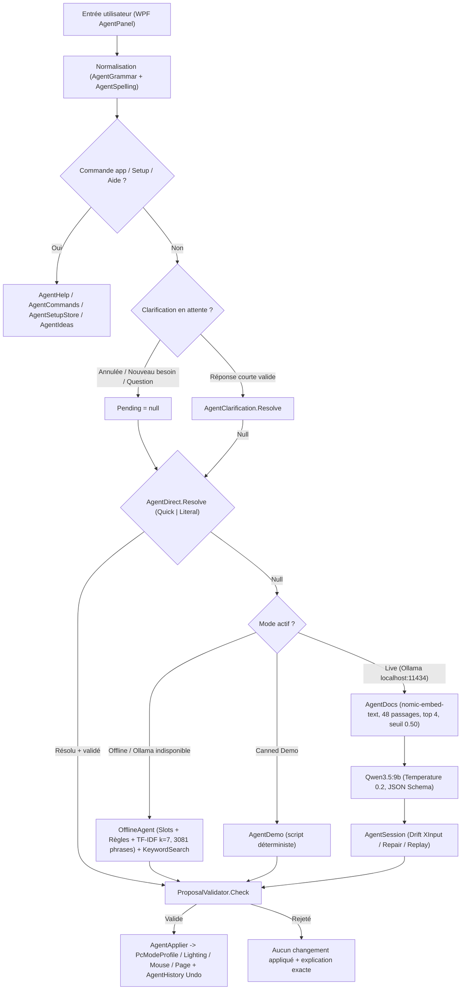

# Rapport d'Ingénierie (PFE) — Chatbot Intelligent Intégré à X20CTL (`Agent XCTL`)

**Équipe (Groupe G17) :** Amjad AAYD, Saad ZINE, Salma RAHMANI  
**Dépôt public :** [`AmjadAAYD/x20ctl-ai-lab`](https://github.com/AmjadAAYD/x20ctl-ai-lab) (branche `lab/qwen-v0.022`)

> **Portée du document :** Livrable d'ingénierie répondant au cahier des charges *« Développer et déployer un chatbot intelligent intégré à une plateforme »*. Chaque choix architectural, algorithmique et ergonomique ci-dessous est justifié par des exigences, des contraintes mesurées, des comparaisons d'options ou des résultats de tests reproductibles issus du dépôt `x20ctl-ai-lab` (branche `lab/qwen-v0.022`).

---

## Synthèse des 4 éléments indissociables du projet

| Élément requis | Réalisation vérifiée dans X20CTL | Emplacements principaux |
|---|---|---|
| **1. Chatbot intelligent** | Pipeline hybride à 3 voies : résolution déterministe (`AgentDirect`), modèle local **Qwen (`qwen3.5:9b` via Ollama + JSON Schema, `MaxTokens = 1024`)** et mode hors-ligne TF-IDF enrichi (`OfflineAgent`, **35** intentions, **3 081** phrases nettoyées) + RAG local **`nomic-embed-text`** (**48** passages, top `4`) + validation stricte (`ProposalValidator`) + gestion du contexte multi-tours (`AgentClarification`, `AgentHistory`). | [AgentSession.cs](../../desktop-dotnet/X20Ctl.Zone/Agent/AgentSession.cs), [AgentOffline.cs](../../desktop-dotnet/X20Ctl.Zone/Agent/AgentOffline.cs), [AgentProposal.cs](../../desktop-dotnet/X20Ctl.Zone/Agent/AgentProposal.cs), [AgentDocs.cs](../../desktop-dotnet/X20Ctl.Zone/Agent/AgentDocs.cs) |
| **2. Plateforme intégrée** | Application desktop **Windows (.NET 10 / WPF)** intégrant l'overlay interactif **`Agent XCTL`** (`AgentPanel`), l'atelier **`Lab / Safety`** (`AgentLab`), le basculement temps réel **Live / Offline / Canned Demo**, l'affichage des courbes avec stick physique en direct, le contrôle LED/RGB, les profils sauvegardés et l'annulation transactionnelle (**Undo**). | [AgentPanel.cs](../../desktop-dotnet/X20Ctl.Product/Agent/AgentPanel.cs), [AgentLab.cs](../../desktop-dotnet/X20Ctl.Product/Agent/AgentLab.cs), [OllamaClient.cs](../../desktop-dotnet/X20Ctl.Product/Agent/OllamaClient.cs) |
| **3. Déploiement accessible & remontée d'incidents** | Exécution 100 % locale sans clé API ni serveur externe requis (mode Offline + Canned Demo autonomes ; Ollama local optionnel pour Qwen/RAG), instructions de compilation/test, harnais CLI d'évaluation, et dispositif intégré de remontée d'incidents (**`Report issue`** dans Settings et Lab/Safety, flux diagnostic guidé, page **Tools → Send feedback** via `FeedbackClient` avec reçu `FB-<24 hex>`). | [README.md](README.md), [FeedbackPage.cs](../../desktop-dotnet/X20Ctl.Product/FeedbackPage.cs), [ProductHost.cs](../../desktop-dotnet/X20Ctl.Product/ProductHost.cs), [demo-script.md](demo-script.md) |
| **4. Rapport & traçabilité PFE** | Traçabilité complète des jalons (M1/M2 → M3 → M5 → Offline → Grammar → Lighting → AI Lab → Live Qwen & RAG), benchmarks comparatifs (**405** tours M2, **69** tours M5 baseline + passages unitaires `--agent-m3`/`--agent-drift`/`--agent-qwen`/`--agent-m5`, **1 125** tests unitaires), analyse des régressions et limites. | [rapport-pfe-chatbot.md](rapport-pfe-chatbot.md), [evaluation.md](evaluation.md), [m5-docs.md](m5-docs.md), [offline-mode.md](offline-mode.md) |

---

## Étape 1 — Caractériser le problème

### 1.1 Besoin réel, public cible et contexte
Les joueurs sur PC utilisant des manettes avancées (ici la gamme **EasySMX X20 / X20 Pro** et modèles compatibles du catalogue `catalog.json`) doivent régler des paramètres techniques interdépendants :
- zones mortes internes/externes (`stick_deadzone`, `stick_full_at`, `trigger_deadzone`, `trigger_full_at`), anti-zone morte (`stick_anti_deadzone`), plafond de sortie (`stick_max_output`), ratio vertical (`stick_axis_ratio`), porte carrée/circulaire (`stick_square_gate`), courbes de réponse cubiques à 2 points de contrôle (`stick_curve_points`, `trigger_curve_points`), remappage, turbo, palettes arrière (`M1`–`M6`), mode souris, mode PC virtuel (`ViGEmBus` + `HidHide`) et éclairage RGB (`led_color`, `led_effect`).

Or la majorité des joueurs exprime son besoin en **symptômes ou intentions de jeu** (*« my aim feels too twitchy »*, *« small stick movements don't register »*, *« set up my triggers for Forza »*, *« my character walks by himself »*), souvent avec fautes d'orthographe, abréviations SMS (*« can u set the rgbs to light blue »*) ou grammaire approximative.

### 1.2 État antérieur et insuffisances
Avant l'intégration de `Agent XCTL`, le réglage s'effectuait manuellement onglet par onglet (**Dashboard, Buttons, Curves, Macros, Vibration, RGB, Mouse, PcMode, Device**) dans le Studio WPF :
1. **Barrière conceptuelle :** ajuster manuellement une courbe cubique `(X1, Y1, X2, Y2)` ou distinguer *dead zone* et *anti-dead zone* demande une expertise technique.
2. **Diagnostic déconnecté :** mesurer un *stick drift* avant d'augmenter la zone morte exigeait plusieurs allers-retours manuels entre l'outil de test d'entrées et l'onglet courbes.
3. **Risque d'erreur et de perte de confiance :** sans historique conversationnel ni **Undo** ciblé, revenir en arrière après plusieurs modifications empilées restait fastidieux.

### 1.3 Cahier des charges initial (résumé)
- Traduire des requêtes en langage naturel (même bruitées) en **actions typées et vérifiables** sur le profil PC Mode (ou navigation/RGB/mesure) sans jamais laisser un LLM exécuter de code arbitraire ni écrire aveuglément dans la mémoire matérielle de la manette.
- Garantir la **confidentialité locale** : aucune donnée de conversation ou documentation ne quitte la machine vers un LLM cloud ; la seule requête réseau existante (`FeedbackClient`) est explicite, déclenchée par l'utilisateur pour envoyer un rapport de bug.
- Offrir un **repli sans modèle (Offline)** et un **mode démonstration déterministe (Canned Demo)** pour les PC dépourvus d'Ollama ou lors de soutenances.

---

## Étape 2 — Décomposer et organiser

### 2.1 Exigences détaillées et traçabilité

| ID | Exigence | Type | Mécanisme d'implémentation | Vérification |
|---|---|---|---|---|
| **EX-01** | Compréhension robuste du langage familier, fautes et SMS | Fonctionnelle | `AgentGrammar.Plain` + `AgentSpelling` (corrections orthogonales + normalisation unités/comparatifs) | `AgentGrammarTests`, `AgentCommandsTests`, `OfflineMessy` (**130/131**) |
| **EX-02** | Sortie structurée strictement typée et bornée par domaine | Sécurité / Qualité | `AgentSession.Schema` + `AgentVocabulary` (**22** actions, **9** pages) + `ProposalValidator.Check` | M2 (**100 %** valide après 1 réparation), `AgentQuickTests` |
| **EX-03** | Mesure physique avant recommandation sur le drift | Fiabilité | Boucle à 2 passes `measure_drift` → `IDriftMeter` (`XInputDriftMeter`) → rejet si `deadzone <= measuredPeak` | `AgentTests`, `AgentOfflineTests.Offline_mode_measures_drift_before_it_sets_a_dead_zone` |
| **EX-04** | Réponses documentaires ancrées et refus du hors-scope | RAG / Anti-hallucination | `AgentDocs` (`EmbeddingSearch` via `nomic-embed-text` / fallback `KeywordSearch`) + validation stricte des index `sources` | `m5-docs.md` (**63/69** baseline ; dernier passage top-4 : **20/23**, **3/3** refus hors-sujet) |
| **EX-05** | Continuité contextuelle et interruption propre | Dialogue | `AgentSession.history` (**10** messages), `PendingClarification`, `AgentClarification.IsNewRequest` + garde `!IsQuestion` dans `OfflineAgent.Chat` | `AgentOfflineCustomizationTests` (clarification multi-tours & interruption par question) |
| **EX-06** | Réversibilité complète des modifications | Sécurité UX | `AgentHistory` (pile d'états `PcModeProfile` avant/après, **Undo** par carte ou en bloc, isolation totale du `demoChosen`) | `AgentPanel.GoBack`, `AgentLookReview` |
| **EX-07** | Mode hors-ligne autonome sans LLM en temps réel | Disponibilité | `OfflineAgent` (slots regex + règles d'exclusion + TF-IDF k=7 sur `phrasebook.json` : **35** intentions, **3 081** phrases) | `AgentOfflineTests` (**40/40** bench, **57/60** held-out) |
| **EX-08** | Laboratoire d'expérimentation & dispositif de remontée d'incidents | Observabilité / Exploitation | `AgentLab` (`Lab / Safety` : température, prompt système, Canned Demo, playground `ProposalValidator`) + bouton `Report issue` → `FeedbackPage` (`FeedbackClient`) | `AgentLookReview` (`8-settings-changes.png`), `AgentDemoTests` |

### 2.2 Cas d'utilisation principaux
- **CU-01 — Réglage sémantique ou direct d'un profil :** l'utilisateur saisit une commande (*« Make my right stick good for sniping »* ou *« can u set the rgbs to light blue »*). L'application applique soit la voie directe, soit Qwen, soit le phrasebook offline, affiche la comparaison visuelle (courbes + bâtonnet physique), déclenche les LEDs/vibrations de retour et crée une carte avec **Undo**.
- **CU-02 — Diagnostic guidé du stick drift :** sur *« my right stick drifts »*, l'agent exige une mesure temps réel via XInput avant de proposer une zone morte supérieure au bruit mesuré.
- **CU-03 — Assistance documentaire (RAG) :** sur *« how do I share my settings? »*, `EmbeddingSearch` fournit les 3 passages les plus proches de `README.md`, `IF-YOUR-CONTROLLER-ISNT-WORKING.md` et `PRIVACY.md` ; sur une question absente des documents (*prix*, *PS5*), le chatbot refuse sans inventer.
- **CU-04 — Clarification puis changement de sujet :** face à une demande ambiguë (*« change the lights »*), l'agent pose une question ciblée ; si l'utilisateur change d'intention ou pose une question informative (*« what does rainbow do? »*), `AgentClarification.IsNewRequest` et `OfflineAgent.Chat` réinitialisent le contexte en attente au lieu de concaténer les deux tours.
- **CU-05 — Expérimentation IA & remontée de problème :** dans **RB Settings → Lab / Safety**, un testeur ou enseignant peut inspecter/réinitialiser le prompt système, ajuster la température, tester des JSON invalides dans le *Bad-output playground*, activer le mode **Canned demo**, ou cliquer **`Report issue`** pour ouvrir la page `Send feedback` pré-remplie avec le modèle actif, le contrôleur et l'état du mode.

### 2.3 Décomposition fonctionnelle et gestion des erreurs
- **Couche linguistique & résolution rapide (`X20Ctl.Zone/Agent/`) :** `AgentGrammar`, `AgentSpelling`, `AgentDirect`, `AgentColors`, `AgentLightingEffects`, `AgentCommands`, `AgentCharacter`.
- **Couche inférence & connaissances (`X20Ctl.Zone/Agent/` + `X20Ctl.Product/Agent/`) :** `AgentSession`, `AgentKnowledge`, `AgentDocs`, `OllamaClient`, `OfflineAgent`, `PhrasebookCleaner`, `AgentLab`.
- **Couche contrôle & persistance (`X20Ctl.Zone/Agent/` + `X20Ctl.Product/`) :** `ProposalValidator`, `AgentApplier`, `AgentHistory`, `AgentSetupStore`, `FeedbackClient`.
- **Cas d'erreur traités explicitement :**
  1. *Ollama absent, arrêté ou modèle manquant :* bascule automatique transparente vers `OfflineAgent` (`AgentPanel.Offline`).
  2. *JSON malformé, action hors vocabulaire, valeur hors bornes (ex. dead zone `260`, full speed stick `40`) ou cible absente du modèle matériel (ex. palette `M5` sur `x20`) :* blocage par `ProposalValidator`, 0 modification appliquée, une tentative de réparation guidée par les erreurs précises (en mode Live) ou refus explicite (*« Nothing changed »*).
  3. *Promesse textuelle sans action / valeur identique à l'état courant / preset non demandé :* détectés et renvoyés pour correction dans `AgentSession.Ask` (lignes 95–126).

---

## Étape 3 — Structurer la solution

### 3.1 Architecture globale



### 3.2 Décisions technologiques motivées

| Décision | Options comparées | Option retenue & justification chiffrée |
|---|---|---|
| **Moteur LLM local** | API cloud payante (latence/clé/fuite vie privée) vs modèle local léger via Ollama | **`qwen3.5:9b` via Ollama (`http://localhost:11434`)** : confidentialité 100 % locale, zéro coût/clé, support natif de `format` JSON Schema. |
| **Contrainte de format JSON** | Prompt libre (`no schema`) vs Schema Ollama non borné vs Schema borné `0–100` | **Schema JSON sans bornes numériques (`AgentSession.Schema`, T=0.2)** : d'après le banc M2 (`405` tours), `no schema` n'obtient que **26 %** de bonnes réponses (**19 %** au 1er essai) alors que `schema` atteint **96 %** (**100 %** de structure valide). Le schéma borné `0–100` (`98 %`) a été **écarté** car un débordement du décodeur (`5` → `5000000000000000` dans `6/162` réponses) devenait `50` silencieusement (indétectable si 50 est légal), tandis que le schéma non borné échoue bruyamment au validateur et est réparé au tour suivant (`100 % Valid after repair`). |
| **Température** | `0.2` vs `0.8` | **`0.2`** : scores quasi identiques (**96 %** vs **96 %** à schema plein), tout en réduisant la variance sur les cas limites (ex. rejet du turbo à 50/s plus fiable à `0.2`). |
| **Base de connaissances dans le prompt** | Règles empiriques courtes (~700–850 tokens) vs significations calculées (`AgentKnowledge`, ~1 700–1 900 tokens) | **`AgentKnowledge` intégré au prompt et aux cartes** : a fait passer la justesse M2 de **89–91 %** à **95–98 %** pour +1 s médian (**2.2 s → 3.0 s**) et corrigé l'erreur métier du preset *« fine »* (qui accélère la courbe à 56 % à mi-course au lieu de ralentir comme *« slow »* à 39 %). |
| **Recherche documentaire (RAG)** | Recherche lexicale (`KeywordSearch`) vs Embeddings locaux (`nomic-embed-text`) | **`nomic-embed-text` en Live (`DocCount = 4`, `Words = 300`), repli `KeywordSearch` en Offline** : sur `m5-docs.md` (baseline `51` passages top-3 : **19/20** embeddings vs **17/20** mots-clés ; dernier passage `48` passages top-4 avec tableaux en paires clé-valeur : **19/20** sur les deux méthodes), la similarité seule ne séparant pas le hors-scope (`0.73–0.74` max hors-sujet vs `0.62–0.64` min répondable), le seuil est fixé à **`0.50`** pour filtrer le bruit manifeste et le refus est confié au prompt + validation stricte des citations. |
| **Classifieur Offline & génération par IA** | LLM embarqué lourd vs règles manuelles seules vs classifieur TF-IDF + synthétiseur Qwen nettoyé | **Voie rapide `AgentDirect` + TF-IDF k=7 + règles + phrasebook généré par Qwen et filtré par `PhrasebookCleaner`** : exécution instantanée sans GPU/Ollama, pas de dérive probabiliste sur les commandes simples, et extension incrémentale propre via `--agent-phrasebook ... --missing-only`. |

### 3.3 Traçabilité des évolutions et corrections apportées
1. **M1–M2 (`12 oct. 2026`):** mise en place du validateur, comparatif 5 variantes (`405` tours), ajout de `AgentKnowledge` (+5–7 pts).
2. **M3 (`886c751`, `949afce`):** courbes personnalisées (`stick_curve_points`), gestion du contexte conversationnel (`Remembered = 10`), normalisation grammaticale (`AgentGrammar`, `AgentSpelling`) et lecture/écriture sécurisée sur X20 Pro uniquement après vérification de lecture.
3. **M5 (`m5-docs.md`):** RAG sur `51` passages baseline (`63/69`), puis `48` passages (`Words = 300`, `DocCount = 4`, tableaux formatés en phrases via `AppendTable`).
4. **Offline, Live Qwen & AI Lab (`253e2a0`, puis travaux courants sur `lab/qwen-v0.022`) :**
   - Rétablissement d'`AgentLab` (`Lab / Safety`) et intégration visible dans `AgentPanel` (page *Agent settings*) avec bouton direct **`Report issue`** connecté à `FeedbackRequested` / `FeedbackClient`.
   - Correction de `AgentDirect.Resolve` (qui contournait `ProposalValidator` pour les commandes littérales comme `stick_full_at 40`), correction d'`AgentGrammar` (collision `"write"`/`"white"`, `"showing up"`, bug `"to light blue"` → `"too light blue"`, et argot joueur `anti-dz`/`sqaure gate`/`digonals`/`rebind`/`rekoil`), correction de `AgentLightingEffects.Asked` (qui ne coupe plus les demandes composées comme rainbow + PC mode), correction de l'interruption par une question, et couverture étendue aux **35** intentions actuelles.
   - Renforcement du mode Live `qwen3.5:9b` (`OllamaClient.MaxTokens = 1024`, historique complet incluant `PcMode`/`Mouse`/`Lighting`/`Page` dans `AgentSession.Ask`, messages d'auto-correction précis pour `GentleCurveProblem`, `CurvePoints`, `led_color`↔`led_effect` et `open_page`, suppression d'exemple couleur trompeur dans `DefaultPrompt`, et ajout du banc `--agent-qwen`).
   - Nettoyage et extension incrémentale du phrasebook avec `qwen3.5:9b` (`--agent-phrasebook ... --missing-only` excluant les jeux de test `OfflineHeldOut`, `OfflineFinal`, `OfflineMessy`, `Cases`) : **3 081** phrases conservées et **551** phrases bruyantes éliminées et journalisées (`phrasebook.dropped.json`).

---

## Étape 4 — Généraliser et transférer

| Composant | Ce qui est immédiatement réutilisable | Ce qui doit être adapté pour un nouveau cas d'usage / domaine |
|---|---|---|
| **Patron Architecte : `AgentSession` + `ProposalValidator` + `AgentHistory`** | Toute la boucle *Normalisation → Voie rapide / LLM / Offline → Validation stricte JSON → Réparation guidée → Application atomique → Undo*. | Remplacer `AgentVocabulary`, `PcModeProfile` et les bornes dans `ProposalValidator` par le schéma d'actions du domaine cible (ex. profil audio, raccourcis IDE, domotique). |
| **Générateur & nettoyeur hors-ligne (`AgentPhrasebook` + `PhrasebookCleaner`)** | Pipeline incrémental `--missing-only` générant des paraphrases avec un LLM local puis les filtrant en 2 passes (règles d'intégrité + vote leave-one-out marge `>= 2`). | Définir la liste d'`OfflineIntent` et les contraintes `Needs(id)` + slots regex propres aux nouvelles entités métier. |
| **Support multi-contrôleurs (`catalog.json`)** | Dès aujourd'hui, le chatbot détecte le modèle (`x20_pro`, `x20`, `d10`, `dune`, `x10`, `x15`, `x05_pro`) et adapte `MacroDraft.PhysicalSlotsFor(modelId)` (ex. accepter `M1–M6` sur X20 Pro et refuser `M5` sur X20). | Ajouter de nouveaux modèles dans `controllers/catalog.json` sans réécrire le validateur. |
| **RAG documentaire (`AgentDocs`)** | Indexation Markdown par sections + cache `doc-embeddings.json` + repli lexical automatique en Offline. | Fournir de nouveaux fichiers `.md` dans `Help` et ajuster le format tabulaire éventuel en phrases explicites. |

**Limites de généralisation observées :**
- Bien que `AgentDocs.AppendTable` convertisse désormais les lignes de tableaux Markdown en phrases clé-valeur (corrigeant `KeywordSearch`), la recherche purement dense (`nomic-embed-text`) classe encore `README.md › Credits` (`0.76`) devant la table des 7 manettes pour *« Is the X20 Pro supported? »*.
- La normalisation grammaticale (`AgentGrammar`) est centrée sur l'anglais (avec quelques équivalents FR/ES/DE courants dans `Casual`), un transfert complet vers le français conversationnel nécessiterait des règles lexicales dédiées ou le recours exclusif au mode Live `qwen3.5:9b`.

---

## Étape 5 — Communiquer (Lancement, Tests et Reproductibilité)

Un autre ingénieur peut cloner, compiler, tester et prolonger le système directement :

1. **Prérequis :** Windows 10/11, **.NET 10 SDK** ; pour le mode Live et la régénération de phrasebook uniquement : **Ollama** avec `qwen3.5:9b` et `nomic-embed-text`.
2. **Compilation & lancement :**
   ```powershell
   dotnet build desktop-dotnet/Product.sln --no-restore
   desktop-dotnet\X20Ctl.Product\bin\Debug\net10.0-windows10.0.19041.0\X20Ctl.exe
   ```
3. **Suite de tests automatisés :**
   ```powershell
   dotnet test desktop-dotnet/X20Ctl.Zone.Tests/X20Ctl.Zone.Tests.csproj --no-restore
   ```
4. **Instructions de test de déploiement pour les évaluateurs (UI & CLI) :**
   - **Sans Ollama (garanti sur toute machine Windows) :** ouvrir le Studio → bouton **`Agent XCTL`** → tester **`Offline mode`** (*« my right stick drifts »*, *« can u set the rgbs to light blue »*, *« what does rainbow do? »*) et ouvrir **RB Settings → Lab / Safety** pour activer **`Canned demo`** selon le scénario pas à pas de [demo-script.md](demo-script.md).
   - **Test de remontée d'incidents :** dans **RB Settings**, cliquer **`Report issue`** (ou passer par le diagnostic / **Tools → Send feedback**) ; vérifier l'ouverture du formulaire pré-rempli et le protocole vers `https://x20-admin.vercel.app/api/feedback` (en mode sandbox `--review-*`, renvoie `FB-SANDBOX` sans émettre sur le réseau).
   - **Harnais d'évaluation CLI :** `--agent-bakeoff <dir>` (M2), `--agent-m5 <dir>` (RAG), `--agent-phrasebook <file> --missing-only` (extension incrémentale), `--agent-phrasebook-clean <repo>`, `--review-agent-look <dir>` (captures WPF).
5. **Guides associés :** [README.md](README.md), [tp-genai-automation.md](tp-genai-automation.md), [demo-script.md](demo-script.md).

---

## Étape 6 — Évaluer et améliorer

### 6.1 Résultats quantitatifs vérifiés

| Banc / Suite de tests | Périmètre mesuré | Résultat vérifié | Source / Date |
|---|---|---|---|
| **M2 Live Bake-off (`qwen3.5:9b`)** | 27 phrases × 3 × 5 variantes (`405` tours) | **96 %** juste (`T=0.2, schema`), **100 %** valide après réparation, **3.0 s** médian (vs **26 %** sans schéma) | [evaluation.md](evaluation.md) |
| **Live Qwen post-amélioration (1 passe)** | `--agent-m3` (`18`), `--agent-drift` (`5`), `--agent-qwen` (`12`) | **`18/18` (`100 %`)** M3, **`5/5` (`100 %`)** Drift, **`11/12` (`92 %`, `100 %` valide)** Qwen | Harnais CLI (`T=0.2, schema`) |
| **M5 RAG Documentation** | Baseline (`51` passages, top 3 × 3 runs = `69`) ; dernier (`48` passages, top 4, 1 run = `23`) | Baseline **63/69** ; dernier passage **20/23** (**19/20** embeddings & **19/20** mots-clés, **3/3** refus hors-scope, `Linux` **1/1**) | [m5-docs.md](m5-docs.md) |
| **Offline `bench`** | `40` phrases canoniques (mode Offline) | **40/40** (**100 %**) | `X20Ctl.Zone.Tests` (après dernière édition) |
| **Offline `examples only` / `both cleaned`** | `60` phrases *held-out* : graines seules vs phrasebook nettoyé | **59/60** (`examples only`) et **59/60** (`both cleaned`, **+7** vs `52/60` historique) | `X20Ctl.Zone.Tests` (après dernière édition) |
| **Offline `held out` (pipeline complet)** | `60` formulations jamais vues | **57/60** (**95,0 %**) | `X20Ctl.Zone.Tests` (après dernière édition) |
| **Offline `messy`** | `131` requêtes avec typos, argot et grammaire cassée | **130/131** (**99,2 %**) | `X20Ctl.Zone.Tests` (après dernière édition) |
| **Suite complète `X20Ctl.Zone.Tests`** | Ensemble des tests unitaires Zone + Agent + Offline + Lighting + Screen | **1 125 / 1 125 réussis** (0 échec, 0 ignoré) | `dotnet test` (après dernière édition) |

### 6.2 Analyse d'erreurs et améliorations documentées
- **Erreur 1 — Contournement du validateur en voie directe :** `AgentDirect.Resolve` retournait `Literal` avant `Quick` sans passer par `ProposalValidator.Check`, ce qui aurait laissé passer `"set the right stick full speed to 40"`. *Correction :* validation systématique de `(Quick(sentence) ?? Literal(sentence))` et refus propre sans action (`Direct_literal_rejects_out_of_range_values`).
- **Erreur 2 — Faux positifs d'ambiguïté & normalisation destructrice :** `"can u make my right analog better for long shots"` déclenchait à tort un rejet d'ambiguïté ; `"can you write to my controller"` corrigeait `"write"` en `"white"` ; `"can u set the rgbs to light blue"` réécrivait `"to light blue"` en `"too light blue"`, faisant perdre le modificateur `"light"`. *Corrections :* lookahead dans `OfflineSupport.cs`, vocabulaire élargi dans `AgentSpelling.cs`, garde couleur après `light` dans `AgentGrammar.cs` et pluriel `rgbs?` dans `AgentColors.cs`.
- **Erreur 3 — Polluants dans `greeting` et décalage de `35` intentions :** `phrasebook.json` ne couvrait que `26` intentions (`3 048` entrées) et contenait `24` phrases parasites dans `greeting` (*« game modes show »*, *« stick actions list »*). *Correction :* ajout des `9` intentions manquantes dans `AgentOffline.cs` + `AgentPhrasebook.cs --missing-only` via `qwen3.5:9b`, puis passage complet de `PhrasebookCleaner.Clean` (**551** rejets, **3 081** phrases propres sur **35** intentions).
- **Erreur 4 — Rupture de tour sur question après clarification :** poser `"what does rainbow do?"` après la question de clarification `"Which colour or lighting effect should I set?"` était recollé en `"change the lights what does rainbow do"` par `AgentClarification` et `OfflineAgent.Chat`. *Correction :* détection via `OfflineAgent.IsQuestion` dans `AgentClarification.IsNewRequest`, `AgentColors.Asked`, `AgentLightingEffects.Asked` et `OfflineAgent.Chat`.
- **Limites actuelles :**
  - Les **3 échecs restants** sur `held out` (`57/60`) et **1** sur `messy` (`130/131`) concernent des formulations frontières où l'extension à `35` intentions a déplacé des poids TF-IDF (`"my changes aren't showing up in game"`, `"ghost inputs on my right analog"`, `"make my right trigger super sensitive"` → classé en courbe personnalisée `trigger_curve_points`).
  - L'écriture directe sur les palettes physiques (`M1`–`M6` hors PC Mode) et le flash firmware restent bloqués faute de protocole matériel validé.
  - Les vérifications visuelles en revue WPF (`--review-agent-look`) montrent la fenêtre Settings/Lab (`8-settings-changes.png`) avec des captures simulées, mais n'ont pas toutes été revalidées manuellement sur une manette physique connectée en fin de session.

---

## Étape 7 — Réfléchir et métacogiter

1. **Hypothèses infirmées par l'expérience :**
   - *« Plus de paraphrases générées par LLM augmentent toujours la précision d'un classifieur TF-IDF » :* faux. L'ajout brut de phrases bruyantes dégradait le score (`48/60`) ; c'est la combinaison **règles d'exclusion + vote k=7 + nettoyage leave-one-out** qui a porté `both cleaned` à `59/60`.
   - *« Borner les entiers dans le JSON Schema (`0–100`) empêche les aberrations numériques » :* faux et dangereux. Les débordements du décodeur (`5000000000000000`) étaient remplacés silencieusement par `50` au lieu d'être rejetés par le validateur.
   - *« Un seuil de similarité cosinus suffit à bloquer le hors-sujet en RAG » :* faux (`0.74` max hors-sujet > `0.64` min répondable).
2. **Décisions à ajuster dans une version future :**
   - Ajouter un re-classement hybride lexical + embeddings sur le RAG (puisque `AppendTable` corrige déjà `KeywordSearch` alors que `nomic-embed-text` privilégie encore `Credits` face à la table *Supported controllers*), puis lancer des campagnes multi-répétitions sur `--agent-qwen`.
   - Remplacer la pondération purement lexicale d'`OfflineAgent` par de petits embeddings locaux pré-calculés si l'empreinte binaire et la latence sans GPU restent acceptables, ou ajouter un jeu de test dédié pour les `9` nouvelles intentions (`held out v2`).
   - Ajouter un bouton explicite d'arrêt propre du harnais `--review-agent-look` une fois le dernier screenshot écrit afin d'éviter toute attente en fin de batch.
3. **Tâches devant impérativement rester sous contrôle humain (HITL) :**
   - Validation finale de modifications matérielles irréversibles ou spécifiques à un firmware (palettes, flash, profils embarqués).
   - Interprétation des recommandations subjectives de jeu (*« feeling »* compétitif) via l'aperçu visuel, l'essai stick en direct et l'**Undo** instantané.
   - Décision d'envoi effectif d'un rapport vers le serveur externe (`Tools → Send feedback` nécessite un clic explicite) et validation manuelle des changements en jeu (risque anti-triche rappelé dans l'avertissement Turbo/Macros).
