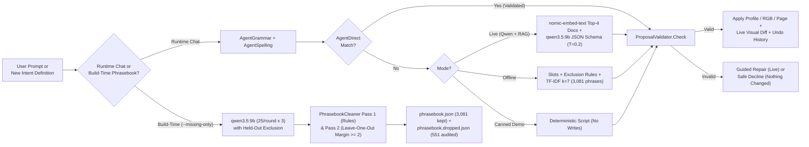

# Exploring the Power of Generative AI to Automate Everyday Tasks

**Name and surname 1:** Amjad AAYD  
**Name and surname 2:** Saad ZINE  
**Name and surname 3:** Salma RAHMANI  
**Group number:** G17  
**Shared document Number:** ……….

---

## Challenge

**Chosen repetitive task:** Configuring advanced game-controller profiles and maintaining an offline natural-language intent phrasebook across 35 controller tuning capabilities (analog stick curves, dead zones, trigger hair-triggers, button remapping, turbo rates, RGB lighting colors/effects, drift calibration, and documentation troubleshooting) inside **X20CTL**.

Rather than showcasing a raw LLM prompt in isolation, this TP demonstrates the complete engineering lifecycle inside branch `lab/qwen-v0.022` of `AmjadAAYD/x20ctl-ai-lab`:

**Problem → Analysis → Design → Automation → Testing → Improvement → Transfer**

---

## Report

### STEP 1 — DATA & PLANNING

I identified the following problem:

* **What is the task?**  
  Two tightly coupled tasks suffered from manual repetition:
  1. **End-user controller tuning & troubleshooting:** translating gameplay symptoms (*"my aim feels twitchy"*, *"small stick movements don't register"*, *"my character walks by itself"*, *"can u set the rgbs to light blue"*) into valid dead zones, cubic Bezier response curves (`X1,Y1,X2,Y2`), outer thresholds, trigger settings, lighting states, or troubleshooting steps.
  2. **Developer offline phrasebook curation (`AgentPhrasebook`):** writing, deduplicating, and verifying hundreds of realistic gamer paraphrases (including slang, typos, and multi-control phrasing) across **35** controller intents without cross-intent label contamination.
* **Who performs it?**  
  PC players configuring EasySMX controllers in X20CTL (`x20_pro` and catalog models), and the developers maintaining X20CTL's deterministic Offline phrasebook mode.
* **How is it currently done?**  
  1. Manually navigating 9 Studio tabs (`Dashboard`, `Buttons`, `Curves`, `Macros`, `Vibration`, `RGB`, `Screen`, `Device`, `Setups`, `Mouse`) and guessing numeric dead-zone percentages or cubic spline points by trial and error.
  2. Hand-writing static keyword lists or seed sentences (`4–12` examples per intent; **189** seeds total across **35** intents).
* **How frequently is it performed?**  
  For players: every time they switch games (FPS sniping vs. racing throttle vs. fighting games), notice stick drift, or adjust lighting/profiles. For developers: every time a new controller capability or UI page is shipped (e.g., adding 9 new intents for lighting, mouse mode, square gate, max output, and vertical axis ratio).
* **How much time does it require?**  
  Manual multi-tab trial-and-error takes several minutes per game and requires re-testing drift separately; manually authoring ~100 clean gamer paraphrases × 35 intents (~3,500+ utterances) plus manually removing cross-intent conflicts would take days.
* **What makes it repetitive, difficult or inefficient?**  
  Setting names are counter-intuitive (*dead zone* vs. *anti-dead zone* vs. *full at*, circular vs. *square gate*), small typos or conversational phrasing break brittle scripts, manual changes lack conversational **Undo**, and raw LLM outputs without validation risk silent bad values or hallucinations.
* **What would success look like?**  
  A hybrid AI workflow integrated inside the X20CTL app (`Agent XCTL` + `Lab / Safety`) that turns natural requests into schema-validated JSON changes in seconds (or deterministic sub-millisecond Offline/Direct execution), backs every decision with `AgentKnowledge` explanations and transactional **Undo**, measures stick drift before modifying dead zones, and expands/cleans the Offline phrasebook across all **35** intents using `qwen3.5:9b` + `PhrasebookCleaner` while keeping `bench` at **40/40** and passing all **1,125** automated tests.

---

### STEP 2 — DECOMPOSITION & ORGANIZATION

I identified:

1. **Inputs:**  
   - User natural-language sentence (chat bar in `AgentPanel`, including typos, slang, multi-clause requests, lighting requests, or doc questions).
   - Live controller state & profile (`PcModeProfile` JSON, physical controller capabilities from `catalog.json` via `MacroDraft.PhysicalSlotsFor(modelId)`, live XInput stick drift readings via `IDriftMeter`, and live Bluetooth battery state).
   - Optional local knowledge base (`48` passages chunked at `Words = 300, Overlap = 50` from `README.md`, `IF-YOUR-CONTROLLER-ISNT-WORKING.md`, and `PRIVACY.md`) + embedded `phrasebook.json` (`3,081` cleaned sentences across `35` intents).
2. **Processing steps:**  
   1. Normalize input (`AgentGrammar.Plain`, `AgentSpelling` fixes, typo/slang expansion, unit/comparative normalization).
   2. Manage multi-turn clarification state (`PendingClarification`, `AgentClarification.IsNewRequest`, question guard in `OfflineAgent.Chat`).
   3. Route through deterministic fast-paths (`AgentCommands`, `AgentSetupWords`, `AgentDirect.Resolve`) or, if non-literal, choose Live Qwen (`qwen3.5:9b` + `nomic-embed-text` RAG), Offline TF-IDF (`OfflineAgent`, `k=7` weighted neighbors + `PhrasebookCleaner` slot rules), or deterministic **Canned Demo** (`AgentDemo`).
   4. If drift measurement is requested (`measure_drift`), read physical XInput peaks first, inject measured data, and generate a dead-zone proposal strictly above measured noise.
   5. Validate JSON structure, vocabulary targets, controller model constraints, and numeric ranges through `ProposalValidator.Check` (with one guided repair loop in Live mode).
   6. Build-time automation (`--agent-phrasebook --missing-only`): invoke `qwen3.5:9b` with neighbor exclusions & slot requirements for uncovered intents, deduplicate against held-out benchmarks, and filter through `PhrasebookCleaner.Clean`.
3. **Decisions:**  
   - **Rule-based / deterministic fast-path vs. GenAI:** Exact commands (`"swap A and B"`, `"can u set the rgbs to light blue"`, `"put rainbow mode on my leds"`) resolve via `AgentDirect`; open-ended gameplay/curve/doc questions use `qwen3.5:9b` + `nomic-embed-text` (or `OfflineAgent` when Ollama is unavailable/disabled); unanswerable or unsupported hardware requests (e.g., `"put jump on M5"` for `x20` without `M5`, out-of-range `"40"` full speed, or battery/price docs) are cleanly declined.
4. **Outputs:**  
   - Validated `PcModeProfile` delta, RGB LED color/effect update, mouse-mode/page switch, before/after curve cards with live physical stick indicator, doc citations, `AgentHistory` Undo entry, and cleaned `phrasebook.json` + `phrasebook.dropped.json` audit log.
5. **Constraints:**  
   - **Privacy & Offline resilience:** zero external LLM API calls or API keys; everything runs locally on `127.0.0.1:11434` (`qwen3.5:9b`, `nomic-embed-text`) or offline without Ollama.
   - **Safety:** never write unverified firmware/paddle memory; reject schema or range violations with 0 side effects; maintain strict separation between evaluation sets (`OfflineHeldOut`, `OfflineFinal`, `OfflineMessy`, `Cases`) and generated phrasebook training data.

#### Automation vs. Human-in-the-Loop (HITL)

| Automated by AI / Pipeline | Kept Under Human Control (HITL) |
|---|---|
| Linguistic cleanup (`AgentGrammar`), fast-path parsing (`AgentDirect`), JSON proposal synthesis (`qwen3.5:9b`), doc retrieval (`nomic-embed-text`), strict schema & range verification (`ProposalValidator`), two-pass phrasebook cleaning (`PhrasebookCleaner`), and `--missing-only` paraphrase generation. | Accepting/enabling PC Mode globally, testing feel via live stick plots, clicking per-turn **Undo** or rolling back via `History`, tuning temperature/system prompt or testing adversarial JSON in **Lab / Safety**, opting in to send bug telemetry via **Report issue** / `FeedbackPage`, and final gameplay verification against online anti-cheat warnings. |

#### Workflow Diagram



---

### STEP 3 — ALGORITHMIC STRUCTURING

1. **System Prompt & Constrained Generation (`AgentSession.Schema` + `AgentKnowledge`):**  
   - **Prompt strategy:** Inject exact controller hardware facts (`MacroDraft.PhysicalSlotsFor`), current `PcModeProfile` values, mathematical setting descriptions computed from `PadProcessor` (`AgentKnowledge`: e.g., `"slow"` gives `39%` output at `50%` deflection whereas `"fine"` gives `56%`), and conditional RAG doc passages (`>= 0.50` cosine score).
   - **Structured output choice (M2 finding):** Using Ollama's JSON `format` schema (**unbounded integers** at `Temperature = 0.2`) raised end-to-end correctness across `405` benchmark turns from **26 %** (`no schema`) to **96 %** (`100 %` valid after 1 repair). Intentionally avoiding `minimum`/`maximum` bounds inside the JSON Schema prevents sampler deadlocks from turning `5000000000000000` silently into `50`; instead, `ProposalValidator` catches any runaway number loudly and triggers repair.
2. **Phrasebook Generation Prompt (`AgentPhrasebook.cs`):**  
   - For each uncovered intent (`--missing-only`), Qwen receives `{intent.Meaning}`, hand-written `{intent.Seeds}`, strict slot requirements (`Needs(id)` e.g., number, two buttons, color, effect, mouse mode, page name), and **explicit neighbor intents** (`Neighbours(intent)`) marked off-limits so paraphrases do not bleed into sibling intents.
3. **Deterministic Guardrails (`AgentDirect`, `ProposalValidator`, `PhrasebookCleaner`):**  
   - `AgentDirect` passes every match through `ProposalValidator.Check`.
   - `OfflineAgent.Chat` + `AgentClarification.IsNewRequest` prevent standalone questions (`"what does rainbow do?"`) from being glued onto previous clarification prompts.
   - `PhrasebookCleaner` enforces structural slot rules (e.g., excluding non-LED mentions of `"rainbow"` when followed by `six`/`6`/`r6` so gaming sentences are kept in trigger intents, while dropping `greeting` entries containing control words) plus a leave-one-out similarity vote (`margin >= 2`).

---

### STEP 4 — GENERALIZATION & TRANSFER

* **Adapting to other controllers & phrasing:** `AgentVocabulary.Paddles(modelId)` reads `controllers/catalog.json`, automatically allowing `M1–M6` on X20 Pro while declining `M5` on X20 (`3/3` in M2 bake-off). New intents require only an entry in `AgentOffline.Intents`, optional `Needs(id)` rule in `AgentPhrasebook.cs`, and running `--agent-phrasebook ... --missing-only`.
* **Transfer to another everyday domain (example: Desktop Audio/EQ Studio or Helpdesk Macros):**  
  * **Directly reusable components:** `AgentGrammar` typo/unit normalization pipeline, `AgentSession` repair/clarification/history pattern, `AgentLab` UI playground + feedback trigger, `AgentDocs` embedding cache + keyword fallback, `OfflineAgent` TF-IDF k=7 matcher, and `PhrasebookCleaner` two-pass filter.
  * **Domain-specific components to swap:** replace `AgentVocabulary` & `ProposalValidator` ranges (e.g., Hz/dB gain bounds instead of stick dead zones), swap `Help/*.md` docs, and supply new seed intents for `--agent-phrasebook`.
  * **Transfer limits:** Markdown tables flatten awkwardly during chunk embedding (`m5-docs.md` showed `0/3` on *"Is the X20 Pro supported?"*); writing tabular facts as atomic sentences is required when transferring RAG docs. Also, `AgentGrammar` rules target English phrasing with only select casual multilingual phrases.

---

### STEP 5 — COMMUNICATION

#### A. Reproducible Tutorial (Step-by-Step Guide for Peers)

1. **Prerequisites:** Install **Windows 10/11**, **.NET 10 SDK**, and **Git**. (Optional for Live Qwen / phrasebook generation: install **Ollama**).
2. **Clone & checkout branch:**
   ```powershell
   git clone <repo-url>
   cd x20ctl-ai-lab
   git checkout lab/qwen-v0.022
   ```
3. **Pull local models (optional for Live mode & phrasebook generator; skip if testing Offline/Demo only):**
   ```powershell
   ollama pull qwen3.5:9b
   ollama pull nomic-embed-text
   ```
4. **Build the full solution:**
   ```powershell
   dotnet build desktop-dotnet/Product.sln --no-restore
   ```
5. **Run the automated test suite (verifies Agent, Offline, Lighting, Grammar, Safety):**
   ```powershell
   dotnet test desktop-dotnet/X20Ctl.Zone.Tests/X20Ctl.Zone.Tests.csproj --no-build
   ```
6. **Launch the application:**
   ```powershell
   desktop-dotnet\X20Ctl.Product\bin\Debug\net10.0-windows10.0.19041.0\X20Ctl.exe
   ```
7. **Open Agent XCTL & test Offline mode (zero model latency):** Click **`Agent XCTL`** in the top bar → open **RB Settings** → toggle **Offline mode On** → return to chat and test:
   - `"Make my right stick good for sniping"` (custom curve)
   - `"can u set the rgbs to light blue"` (direct color resolution + character LED preview)
   - `"change the lights"` followed by `"what does rainbow do?"` (clarification + question interruption)
   - Click **Undo** on any change card to restore the previous state.
8. **Explore the AI Lab & Validator Playground:** Open **RB Settings** → expand **`Lab / Safety`**. Toggle **Canned demo**, send `"demo aim"`, `"demo bad output"`, then click **Validate output** in the *Bad-output playground* with `"260"` (rejected) vs. `"6"` (valid, nothing applied).
9. **Test Incident Reporting:** Click **`Report issue`** in **RB Settings** or **Lab / Safety** to launch the pre-filled feedback workflow (`FeedbackPage` / `FeedbackClient`).
10. **Regenerate & clean missing Offline intents with GenAI (optional):** Start Ollama (`ollama serve`), then run:
    ```powershell
    X20Ctl.exe --agent-phrasebook desktop-dotnet\X20Ctl.Zone\Agent\phrasebook.json --missing-only
    ```
    Inspect `docs\agent\phrasebook.progress.txt` and `docs\agent\phrasebook.dropped.json` to audit kept vs. rejected paraphrases.
11. **Troubleshooting:** If Ollama is stopped or absent, Agent XCTL automatically switches to **Offline · phrasebook**. If a previous bakeoff/harness wrote fixture files, remove temporary folders or use isolated temp output paths outside AppData.

#### B. Video Demonstration Outline (Concise — ~4 min 30 s, English)

1. **0:00 – 0:30 (30 s) — The Problem:** Show the X20CTL Curves/Buttons/RGB tabs manually and illustrate how configuring dead zones, curves, drift, and lighting from gameplay complaints is slow and jargon-heavy.
2. **0:30 – 1:00 (30 s) — Workflow Overview:** Present the controller-shaped `Agent XCTL` UI and explain the 3-tier architecture (Direct fast-path → Local Qwen + RAG / Offline TF-IDF → `ProposalValidator` + Undo).
3. **1:00 – 2:00 (1 min) — GenAI & AI Lab Setup:** Open **RB Settings → Lab / Safety**, show `qwen3.5:9b` (`T=0.2`), inspect the system prompt enriched with `AgentKnowledge`, test the **Bad-output playground** (`260` rejected vs `6` valid without applying), and briefly show `--agent-phrasebook --missing-only` logs (`3,081` kept, `551` dropped across `35` intents).
4. **2:00 – 3:00 (1 min) — Live / Offline / Demo Walkthrough:** Run **Canned demo** (`demo aim`, `demo bad output`), switch to **Offline mode**, test `"can u set the rgbs to light blue"`, `"put rainbow mode on my leds"`, `"change the lights"` → `"what does rainbow do?"`, and trigger **Undo** + **`Report issue`**.
5. **3:00 – 4:00 (1 min) — Before vs. After Results:** Show verified benchmark outcomes: M2 schema (**96 %** vs **26 %** unguided), latest single-pass Live Qwen checks (`--agent-m3` **18/18**, `--agent-drift` **5/5**, `--agent-qwen` **11/12**), M5 RAG (**63/69** baseline; **20/23** single-pass top-4 with **19/20** embeddings & **19/20** keywords, **3/3** out-of-scope refusals), Offline (`40/40` bench, `57/60` held-out, `59/60` both-cleaned vs `52/60` previously, `130/131` messy), and **`1,125/1,125` passing unit tests**.
6. **4:00 – 4:30 (30–60 s) — Limits, Human Control & Transfer:** Highlight unverified hardware paddle write refusal, HITL Undo/feedback controls, and how the exact JSON-schema + two-pass phrasebook pattern transfers to any structured desktop assistant.

---

### STEP 6 — SELF-EVALUATION & CREATIVITY

#### Measurable Before / After Comparison (Observed Data)

| Metric | Before / Baseline | After / Current State | Source |
|---|---|---|---|
| **Structured JSON Accuracy (`qwen3.5:9b`)** | **26 %** right (`no schema`), **89–91 %** (`baseline schema` without `AgentKnowledge`) | M2 **96 %** (`T=0.2, schema + AgentKnowledge`, `405` turns); latest single-pass checks: **`--agent-m3` 18/18 (100 %)**, **`--agent-drift` 5/5 (100 %)**, **`--agent-qwen` 11/12 (92 %, 100 % valid)** | [evaluation.md](evaluation.md), CLI live evals |
| **RAG Doc Retrieval (`48` passages, `DocCount = 4`)** | Baseline (`51` passages, top 3): **17/20** keywords, **19/20** embeddings, **63/69** (3 runs) | Latest single pass (`Words = 300`, table row pairs): **19/20** keywords & **19/20** `nomic-embed-text`; **20/23** right (`Linux 1/1`, `PC mode 6/6`, **3/3** out-of-scope refused) | [m5-docs.md](m5-docs.md) |
| **Offline Intent Coverage & Phrasebook** | `26` intents, `2,459` merged entries (including `24` noisy greeting leaks & `0` entries for 9 newer features) | **35** intents (**189** seeds), **3,081** cleaned sentences (**551** noisy/cross-intent rows dropped & audited) | `phrasebook.json`, `phrasebook.dropped.json` |
| **Offline `both cleaned` Held-Out Score** | `52/60` historical merged baseline | **59/60** (`+7`), `40/40` bench, `57/60` full pipeline held-out, `130/131` messy | `dotnet test` (`X20Ctl.Zone.Tests`) |
| **Literal Safety & Unit Regression Suite** | `AgentDirect.Literal` bypassed validator; `to light blue` mangled to `too light blue`; lighting interceptor dropped compound clauses | Full **1,125 / 1,125** passing tests (0 failures, 0 skipped) | `dotnet test` (verified post-final edit) |

* **Edge-case robustness & creativity:** The assistant wears the requested controller RGB color visually (`AgentPanel`), graphs stick deflection live on before/after curves, laughs briefly on off-topic math questions while declining safely, and exposes a built-in **Lab / Safety** sandbox plus direct **Report issue** integration for reproducible testing.

---

### STEP 7 — REFLECTION & METACOGNITION

#### Shared Technical Findings
1. **What assumptions were incorrect?**  
   - Adding more raw LLM paraphrases automatically beats fewer clean examples (in reality, uncleaned LLM noise hurt matching until two-pass `PhrasebookCleaner` + `k=7` voting + slot exclusion rules were introduced).
   - Bounded JSON Schema numeric constraints (`0–100`) are safer than unbounded integer schemas (in reality, decoder bounds masked `5 → 50` silently, whereas unbounded schemas failed loudly in `ProposalValidator` and self-repaired).
   - Text normalization rules like `to + adjective → too + adjective` are safe without domain context (`"to light blue"` collided with `"too light"` until guarded against color names).
2. **What would we improve next?**  
   - Add hybrid lexical + embedding reranking specifically for tabular doc queries (since header-paired `AppendTable` fixed `KeywordSearch`, yet pure `nomic-embed-text` cosine still ranks `Credits` ahead of `Supported controllers`), run multi-repeat (`3x`) `--agent-qwen` sweeps to smooth `T=0.2` variance (such as `"Make my aim feel less responsive"` conservatively asking which stick), and make `--review-agent-look` exit deterministically right after screenshot capture.

#### Individual Reflections *(complete individually before submission)*

**Member 1 — Amjad AAYD:**  
* Most useful lesson from automating this task with GenAI: ………………………………………  
* Hardest debugging/validation challenge encountered: ……………………………………………  
* Where human judgment remained essential: …………………………………………………………  

**Member 2 — Saad ZINE:**  
* Most useful lesson from automating this task with GenAI: ………………………………………  
* Hardest debugging/validation challenge encountered: ……………………………………………  
* Where human judgment remained essential: …………………………………………………………  

**Member 3 — Salma RAHMANI:**  
* Most useful lesson from automating this task with GenAI: ………………………………………  
* Hardest debugging/validation challenge encountered: ……………………………………………  
* Where human judgment remained essential: …………………………………………………………  
